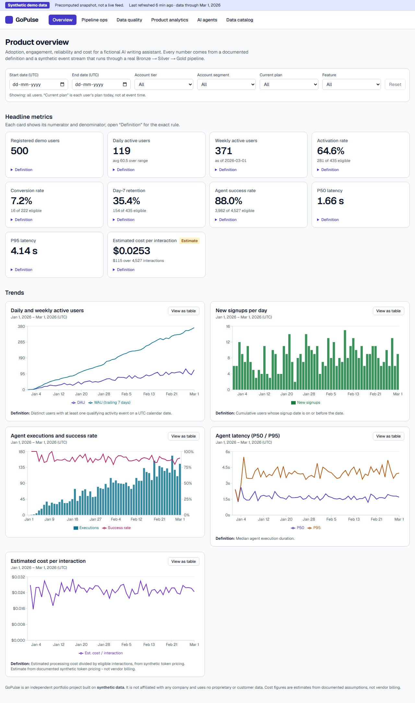
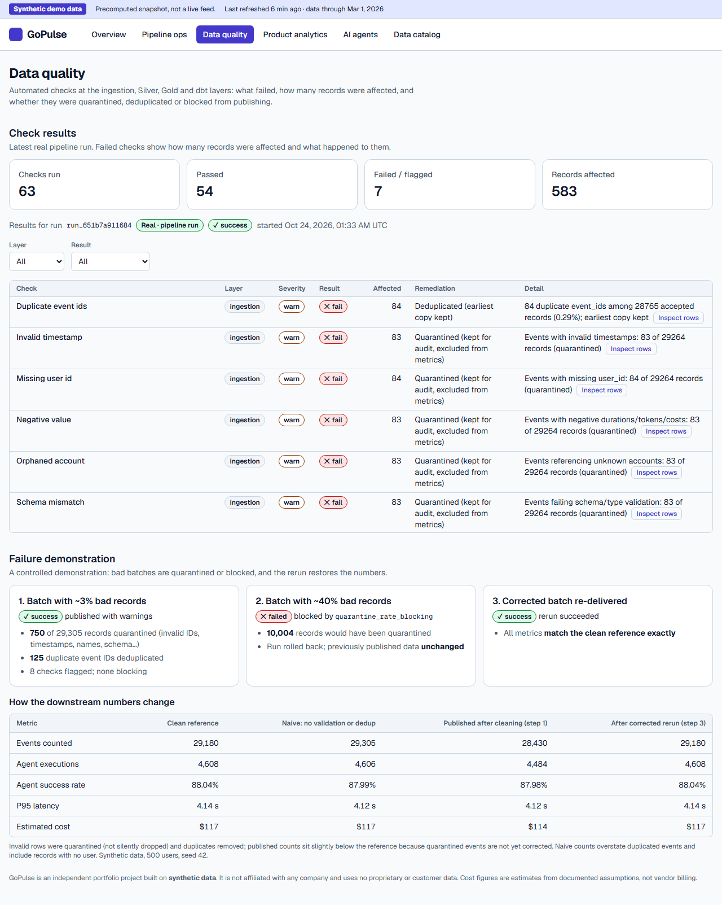
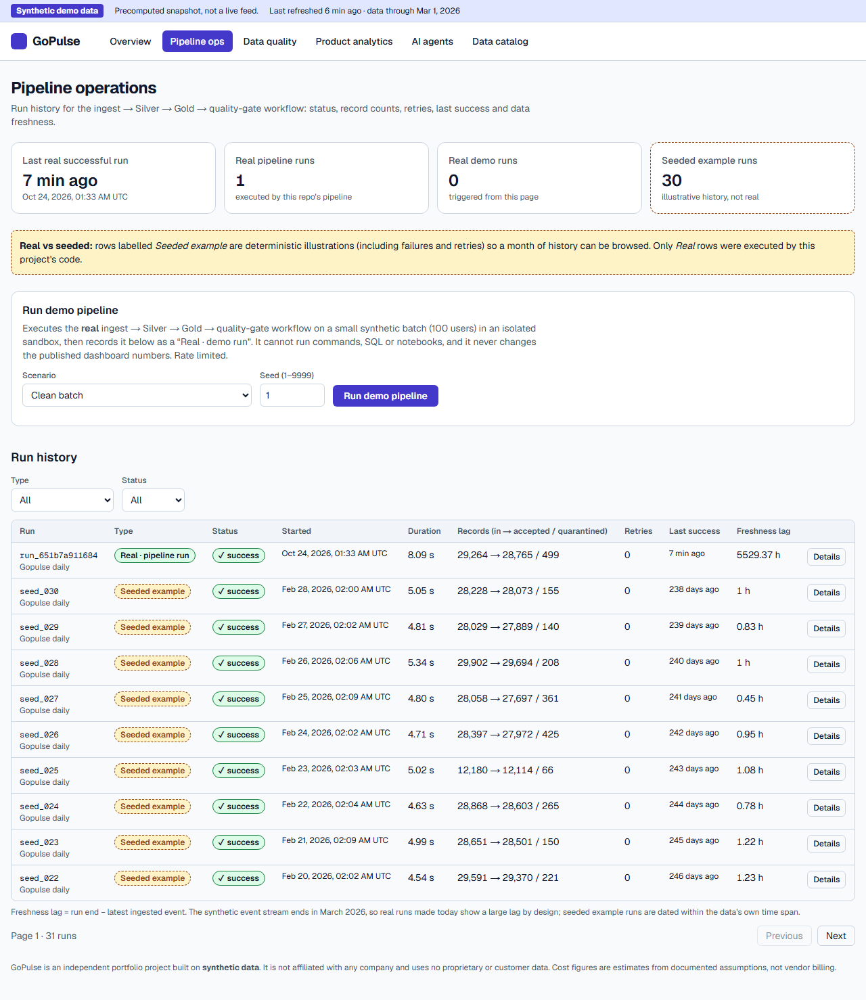
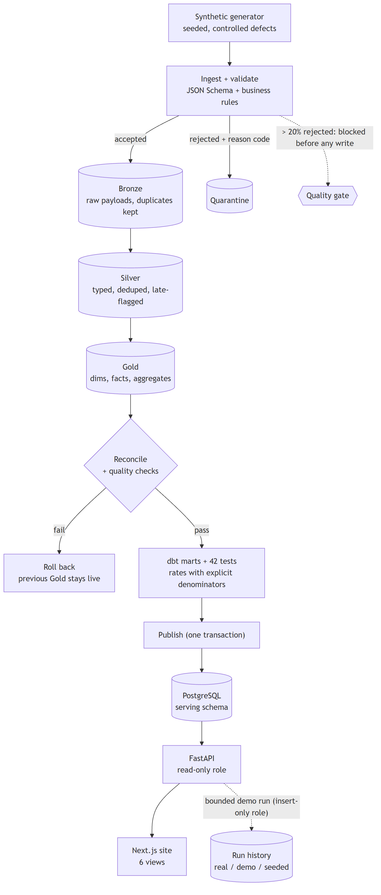

# GoPulse

**An end-to-end data platform and analytics site for an AI product, built on synthetic data.**
Raw events → validated, deduplicated lakehouse (Bronze/Silver/Gold) → tested dbt models → PostgreSQL → FastAPI → an accessible Next.js site, with
data-quality gates, orchestration, and a Spark/Delta implementation proven equivalent to the local one.

> **Independent portfolio project.** Not affiliated with any company. All data is synthetic and labelled as such everywhere it appears.

| | |
|---|---|
| **Status** | Built and tested end to end; runs locally in three commands. **Not deployed** - there is no live URL, and no cloud run history, runtime or cost is claimed. |
| **Verified** | 189 automated tests (103 Python, 27 unit, 54 end-to-end, 5 Spark parity) · WCAG A/AA clean in light and dark · whole stack exercised in containers on a fresh database |
| **Not verified** | GitHub Actions has not run (no remote yet) · nothing has run on a Databricks workspace · no load testing beyond the local benchmarks below |



<table>
<tr>
<td width="50%"></td>
<td width="50%"></td>
</tr>
<tr>
<td><sub><b>Data quality</b> - what failed, how many records, quarantined or blocked, and how the numbers change.</sub></td>
<td><sub><b>Pipeline ops</b> - real runs vs clearly-labelled seeded history; a bounded "run the real pipeline" action.</sub></td>
</tr>
</table>

A captioned walkthrough recording is in [`docs/media/walkthrough.webm`](docs/media/walkthrough.webm) (script: [walkthrough.md](docs/walkthrough.md)). More views:
[analytics](docs/media/screenshots/analytics.png) · [agents](docs/media/screenshots/agents.png) · [catalog](docs/media/screenshots/catalog.png) ·
[dark mode](docs/media/screenshots/overview-dark.png) · [mobile](docs/media/screenshots/overview-mobile.png).

## Run it (Docker)
```bash
git clone https://github.com/ragurajakrishnan15/GoPulse.git && cd GoPulse
cp .env.example .env                               # local-only placeholder credentials
docker compose up -d --build                       # postgres + api + web, all health-checked
docker compose --profile seed run --rm seed        # generate data -> pipeline -> dbt -> publish  (about a minute; re-runnable)
# site: http://localhost:3000     API docs: http://localhost:8000/docs
```
Development without containers (only Postgres in Docker): see [docs/api.md](docs/api.md) and [apps/web/README.md](apps/web/README.md).

## What it demonstrates

**Reliability.** Bad data never silently disappears or poisons metrics. Invalid records are *quarantined with a reason code*; duplicates are
deduplicated (earliest ingest wins); a batch that is > 20% invalid is *blocked before anything is written*. Ingest → Silver → Gold → reconcile → quality
gate runs in **one transaction**, so a failure leaves the previous Gold untouched. Reruns and backfills are idempotent, and late events repair the
partition they belong to. *Evidence:* day-by-day backfill of 14 daily deliveries (with late arrivals) produces Gold identical, row for row, to a single full load;
replaying any day or the whole range changes nothing; in a real Airflow run a transient failure was retried (try 2) while a quality-gate failure was
**not** retried and blocked downstream tasks.

**Modelling.** Raw events become a documented Silver stream, eleven Gold tables (grain and key stated for each) and eight dbt marts. Every metric has an
explicit numerator, denominator, window, eligibility rule and time zone ([metrics.md](docs/metrics.md)). Cohort rates are `NULL` until their window has
elapsed, and user-level and account-level denominators are never mixed. *Evidence:* 42 dbt tests, mart-vs-fact reconciliation, and the API's numbers are tested to equal the marts.

**Observability.** Every run records tasks, counts, retries, watermark and freshness; 21 quality checks plus dbt tests are persisted with affected-record
counts and a remediation status. The site lets you trace a failed check to the actual failing rows and to the effect on downstream metrics
([failure demonstration](docs/quality.md)). Real executions, bounded demo runs and seeded example history are labelled differently.

**Performance and cost (measured).** Profiling showed ingestion was ~90% of runtime. A fast path in front of the JSON-Schema validator plus bulk
loading cut a 5,000-user run from **46.6 s to 10.5 s (4.5×)** with identical outputs; the fast path is fuzz-tested against the schema (and the fuzzing
found a real crash, now fixed). Scaling is linear to 600k events in ~24 s. The same measure-first approach on the other layers: `/overview` API latency
**63.5 → 20.8 ms (3.1×)**, with throughput under 20 concurrent clients **51 → 108 req/s**; and page layout shift (CLS) **cut on every page, e.g. Pipelines
0.099 → 0.012**, after skeletons were sized to match real content. See [benchmarks](docs/benchmarks.md) for method, variance and caveats (one machine, localhost, no throttling).

**Product thinking.** Funnels state a denominator per stage and warn that they show association, not causation. Cost per interaction is an *estimate*
from documented token pricing and says so. Filters tell you when they don't apply instead of silently ignoring you.

**Engineering judgement.** Least-privilege database roles (the dashboard role *cannot* write - tested). A demo endpoint that cannot accept commands,
SQL, paths or credentials, is rate-limited and bounded. Tests that can actually fail (a dbt test is proven to catch a corrupted table). Honest scope:
Databricks is implemented and parity-tested locally but not deployed.

## Architecture


Details, orchestration ownership, runtime topology and trust boundaries: [docs/architecture.md](docs/architecture.md) · [lineage](docs/lineage.md) ·
[data dictionary](docs/data_dictionary.md).

## Stack
| Concern | Used |
|---|---|
| Processing | Python, SQL, **DuckDB + Parquet** locally; **PySpark + Delta Lake** (parity-tested, Databricks job defined) |
| Modelling & tests | dbt (`dbt-duckdb`), pytest, custom quality-gate checks (`pipelines/jobs/quality.py`) |
| Orchestration | Apache Airflow (local, executed in a container), Databricks Workflows (defined, not run) |
| Serving | PostgreSQL 16, FastAPI, Pydantic-validated filters |
| Web | Next.js 16, React 19, TypeScript, Tailwind CSS 4, Recharts |
| Tooling | Docker Compose, GitHub Actions, ruff, Vitest, Playwright + axe |

## Repository layout
```
apps/web/              Next.js site (6 views), unit + e2e tests
services/api/          FastAPI app + 53 integration tests
pipelines/
  generators/          seeded synthetic data with injectable defects
  ingestion/           event JSON Schema + validator (with fuzz-tested fast path)
  jobs/                ingest, silver, gold, quality gate, run orchestrator, dbt runner, failure demo, daily batches
  spark/               PySpark + Delta implementation (parity with jobs/)
  serving/             Postgres schema, publish job, seeded history
  catalog/             catalog metadata (feeds the site and generated docs)
transformations/dbt/   staging + marts, 42 tests
orchestration/         Airflow DAG (+ framework-free task logic) and a Databricks-trigger example
databricks/            Asset Bundle job, notebooks, parity tests
quality/               unit + integration tests for the pipeline, dbt, orchestration
infrastructure/docker/ api, web, pipeline, postgres, airflow, spark images
scripts/               benchmarks, doc generation, seed job
docs/                  architecture, metrics, quality, API, CI, decisions, benchmarks, generated lineage + data dictionary
.github/workflows/     CI (8 jobs) and a gated deploy skeleton
```

## Testing
| Suite | Count | Covers |
|---|---|---|
| Python unit | 18 | generator determinism, validation rules, fast path vs schema (30,000 mutations), Databricks bundle |
| Python integration | 32 | pipeline reconciliation, idempotency, rollback, quality gate, dbt (incl. proving tests catch corruption), failure demo, backfill equivalence |
| API (needs Postgres) | 53 | reconciliation to dbt marts, filter validation and injection safety, pagination, role permissions, rate limiting, empty database |
| Web unit (Vitest) | 27 | formatters, filter parsing, API client, async state machine, components |
| End-to-end (Playwright) | 54 | every page, axe WCAG A/AA in light + dark, phone layout, filters, error/empty/loading/stale states, demo run, keyboard |
| Spark parity (container) | 5 | PySpark/Delta == DuckDB, row for row (Silver + 10 Gold tables compared) |

`ruff check .` · `pytest` · `cd apps/web && npm test && npx playwright test` · Spark: [databricks/README.md](databricks/README.md). CI design: [docs/ci.md](docs/ci.md).

## Decisions and trade-offs
The reasoning behind the main choices is in [docs/decisions.md](docs/decisions.md): DuckDB locally with Spark parity instead of local Spark; one
transaction per run; partition rebuilds instead of a fixed late-data lookback; retry only what retrying can fix; Delta promotion order (no multi-table
transactions); one API worker until there is a shared rate limiter; deploy gated off by default.

## Known limitations
* **Not deployed**; deployment is the one phase deliberately left out ([ci.md](docs/ci.md) has the gated workflow skeleton).
* **Databricks/Unity Catalog/Asset Bundle are untested on a real workspace**; the Spark code is verified locally only, and its validation is row-wise Python (fine for a demo, not at production volume).
* Synthetic data is simple: no seasonality or real behavioural structure, so *the analytics are not findings* - they exist to exercise the pipeline.
* "Plan" filter uses each user's *current* plan, not their plan at event time.
* The demo rate limiter is in-memory (single API worker).
* GitHub Actions workflows are linted and their commands run locally, but they have not run on GitHub.

## Documentation index
[Architecture](docs/architecture.md) · [Metric definitions](docs/metrics.md) · [Event contract](docs/event_contract.md) · [Pipeline](docs/pipeline.md) ·
[Data quality & failure demo](docs/quality.md) · [API](docs/api.md) · [Orchestration](docs/orchestration.md) · [CI/CD & containers](docs/ci.md) ·
[Benchmarks](docs/benchmarks.md) · [Decisions](docs/decisions.md) · [Portfolio notes](docs/PORTFOLIO.md) · [Walkthrough](docs/walkthrough.md) ·
[Original brief & Definition of Done](docs/SPEC.md) · [Project plan](docs/PROJECT_PLAN.md)
