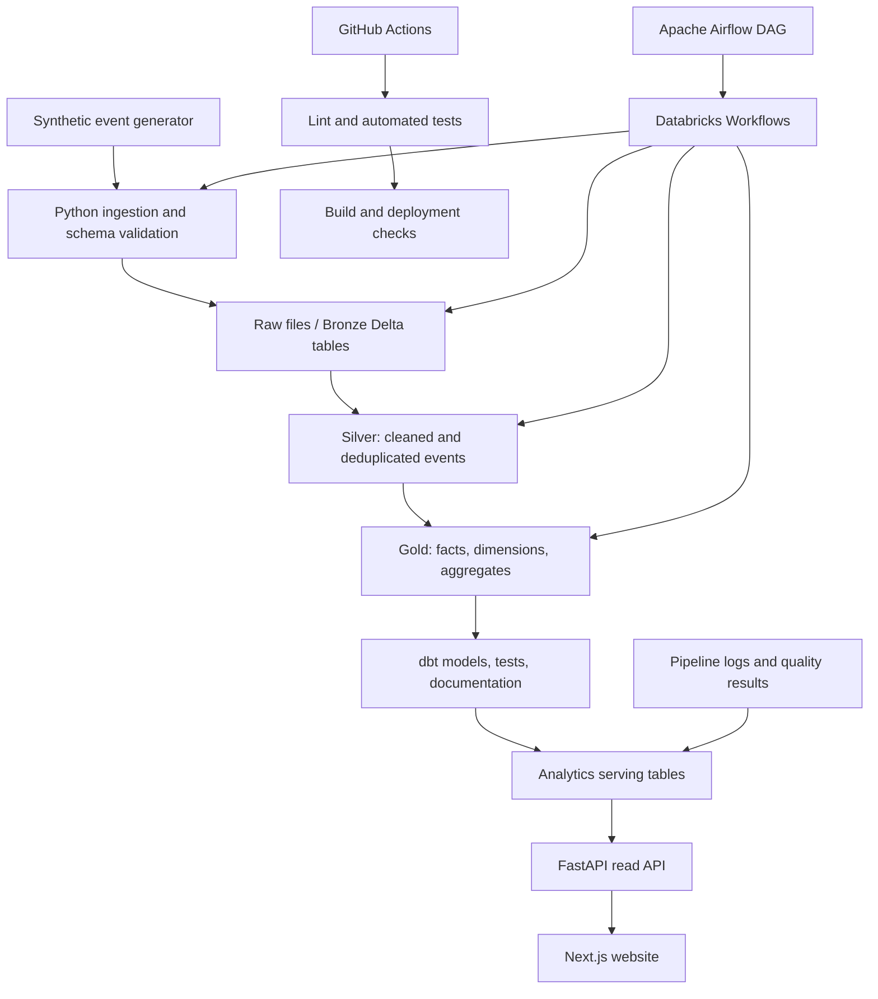

> **This is the original project brief** (the specification GoPulse was built from). It is kept for reference and its Definition of Done below
> is updated with the verified status. For what exists and how to run it, read the top-level [README](../README.md).
>
> Where the build deliberately differs from this brief (e.g. DuckDB as the local engine, Databricks implemented but not deployed), the reasons
> are recorded in [decisions.md](decisions.md).

# GoPulse — AI Product Data Engineering Platform (original brief)

> An end-to-end lakehouse and product analytics platform for understanding AI-assistant adoption, engagement, reliability, and business impact.

GoPulse is a portfolio project designed to demonstrate data engineering practices relevant to product-led AI applications: reliable ingestion, lakehouse transformations, reusable data models, orchestration, data quality, observability, and self-service analytics.

**Portfolio note:** GoPulse is an independent demonstration project. It is not affiliated with Superhuman and does not use Superhuman's proprietary data. The initial dataset is synthetic.

---

## Table of Contents

- [Goals](#goals)
- [Product Experience](#product-experience)
- [Architecture](#architecture)
- [Technology Stack](#technology-stack)
- [Data Model](#data-model)
- [Metrics and Definitions](#metrics-and-definitions)
- [Pipeline Design](#pipeline-design)
- [Data Quality and Reliability](#data-quality-and-reliability)
- [Website and API Requirements](#website-and-api-requirements)
- [Repository Structure](#repository-structure)
- [Implementation Roadmap](#implementation-roadmap)
- [Local Development](#local-development)
- [Testing and CI/CD](#testing-and-cicd)
- [Deployment Plan](#deployment-plan)
- [Security and Cost Controls](#security-and-cost-controls)
- [Definition of Done](#definition-of-done)
- [Portfolio Presentation](#portfolio-presentation)

---

## Goals

Build one coherent, deployable platform that demonstrates the following capabilities:

1. Ingest and process user activity, product events, account attributes, and AI-agent interactions.
2. Transform raw data into tested, documented, reusable analytics models.
3. Measure onboarding, activation, engagement, retention, conversion, and account adoption.
4. Monitor pipeline runs, data freshness, failures, duplicates, and quality checks.
5. Make analytics accessible through an interactive public website and API.
6. Demonstrate production-minded practices: incremental processing, idempotency, version control, automated tests, CI/CD, documentation, and cost awareness.

### Non-goals

- Reproducing Superhuman's internal systems or metrics.
- Using real customer data, credentials, or proprietary event schemas.
- Claiming that simulated pipeline runs are real cloud executions.
- Building a full commercial multi-tenant analytics product.

---

## Product Experience

The public website should be useful without requiring a recruiter to create an account or access a Databricks workspace. Use a clearly labeled demo dataset.

### 1. Product Overview

Show headline metrics and time-series trends:

- Total registered demo users
- Daily and weekly active users
- Activation rate
- Retention by cohort
- Feature adoption
- Conversion rate
- Agent success rate
- P50/P95 latency
- Estimated cost per interaction

Provide date, feature, plan, and account-segment filters. Every chart should show its date range and metric definition.

### 2. Pipeline Operations

Show a run-history table with:

- Pipeline and task name
- Start/end time and duration
- Status
- Input/output record counts
- Retry count
- Last successful run
- Data freshness
- Error summary and log excerpt

A **Run demo pipeline** action may execute a safe, bounded demo workflow. It must not expose arbitrary shell commands, SQL, notebook paths, or cloud credentials. Clearly distinguish real executions from seeded example history.

### 3. Data Quality

Show check results, severity, affected records, and remediation status. Include controlled examples of:

- Duplicate event IDs
- Missing user IDs
- Invalid timestamps
- Unknown event names
- Orphaned account references
- Schema mismatches
- Stale partitions

Allow users to inspect a sample of failed rows with synthetic data. Show how deduplication or quarantine changes downstream counts.

### 4. Product Analytics

Provide:

- Signup-to-activation funnel
- Feature adoption over time
- Retention cohorts
- Conversion funnel
- Daily/weekly active-user trends
- Account-level adoption comparisons

Funnel stages and denominators must be documented. Avoid presenting correlation as causation.

### 5. AI Agent Insights

Analyze synthetic agent execution events:

- Success and failure rate
- Failure categories
- P50/P95 latency
- Token usage
- Estimated cost by agent or feature
- Retry rate
- Interaction volume over time

Cost figures must be labeled as estimates based on documented assumptions, not actual vendor billing.

### 6. Data Catalog

For each dataset/model, display:

- Description and business purpose
- Grain and primary key
- Column names, types, and descriptions
- Upstream and downstream dependencies
- Refresh cadence and last refresh
- Tests and current status
- Metric definitions and links to source SQL/dbt models

---

## Architecture



### Architectural principles

- **Databricks is the primary lakehouse** for the full cloud implementation.
- **Delta Lake** provides managed table storage and transactional table operations.
- **PySpark and SQL** perform transformations.
- **dbt** defines documented, testable analytical models in a compatible SQL execution environment.
- **Databricks Workflows** is the primary production scheduler for the Databricks implementation.
- **Apache Airflow** demonstrates dependency orchestration and integration. Do not run both schedulers over the same production pipeline unnecessarily.
- **PostgreSQL** serves application metadata, demo run history, and selected precomputed results; it is not a replacement for the lakehouse.
- **FastAPI** provides read endpoints and narrowly scoped demo actions.
- **Next.js and TypeScript** provide the public interface.
- **GitHub Actions** runs automated checks on pull requests and the main branch.

The local environment should work without paid cloud access using a documented local development path. The cloud lakehouse implementation should be a separately documented integration.

---

## Technology Stack

| Area | Technology | Purpose |
|---|---|---|
| Language | Python | Ingestion, generators, API, automation |
| Query language | SQL | Transformations, analytical models, validation |
| Distributed processing | Apache Spark / PySpark | Batch and incremental data processing |
| Lakehouse | Databricks + Delta Lake | Cloud storage and compute for analytical data |
| Modeling | dbt | Reusable models, tests, docs, lineage |
| Orchestration | Databricks Workflows | Scheduled cloud jobs and dependencies |
| Orchestration example | Apache Airflow | DAGs, retries, dependencies, backfills |
| API | FastAPI | Typed, documented backend endpoints |
| Website | Next.js + React + TypeScript | Interactive public demo |
| UI styling | Tailwind CSS | Responsive application styling |
| Charts | Recharts or an equivalent React chart library | Interactive analytics |
| Serving database | PostgreSQL | Demo metadata and aggregated results |
| Data quality | dbt tests + custom Python/Pytest checks; optionally Great Expectations | Schema, uniqueness, null, freshness, and business-rule validation |
| Testing | pytest, API integration tests, frontend tests | Correctness and regression prevention |
| Version control | Git + GitHub | Code review and change history |
| CI/CD | GitHub Actions | Lint, test, build, and deployment checks |
| Packaging | Docker + Docker Compose | Reproducible local services |
| Frontend hosting | Vercel or equivalent | Public HTTPS website |
| API hosting | Docker-capable host such as Render or equivalent | Public HTTPS backend |
| Database hosting | Managed PostgreSQL provider | Persistent serving data |
| AI-assisted development | Codex or Cursor | Assisted implementation, reviewed and tested by the developer |
| Optional business dashboard | Power BI | Additional BI demonstration if useful |

Choose versions that are mutually compatible at implementation time and pin them in dependency files. Some dbt adapters and execution targets differ; document the adapter used and do not imply that every dbt model runs natively on every environment.

---

## Data Model

### Source event types

Generate realistic but synthetic records such as:

- `user_signed_up`
- `onboarding_started`
- `onboarding_completed`
- `feature_opened`
- `suggestion_shown`
- `suggestion_accepted`
- `agent_started`
- `agent_completed`
- `agent_failed`
- `subscription_started`

Use stable identifiers and timestamps. Include an `event_id`, `event_name`, `event_timestamp`, `ingested_at`, `user_id`, optional `account_id`, `session_id`, `feature_id`, and event properties. Agent records should include execution ID, agent type, status, duration, retry count, token counts, and a synthetic cost estimate where relevant.

### Bronze layer

Retain raw events with ingestion metadata. Preserve original payloads for auditability and replay. Avoid silently dropping malformed data; route invalid records to a quarantine location with a reason.

### Silver layer

Normalize types and event names, validate required fields, deduplicate by stable event ID, handle late-arriving events, and enrich records with validated dimensions. Make reruns idempotent.

### Gold layer

| Model | Grain | Purpose |
|---|---|---|
| `fct_product_events` | One row per accepted unique event | Canonical behavioral event facts |
| `fct_agent_interactions` | One row per agent execution | Agent outcome, latency, and usage analysis |
| `dim_users` | One row per user | Signup date and permitted synthetic attributes |
| `dim_accounts` | One row per account | Synthetic account tier and segment |
| `dim_features` | One row per feature | Feature names and categories |
| `fct_daily_user_activity` | One row per user per activity date | Daily activity and engagement |
| `fct_account_adoption` | One row per account per reporting period | Account adoption and usage |
| `agg_product_metrics_daily` | One row per date and selected dimensions | Fast KPI queries for the dashboard |

Document each model's grain, primary key, joins, timestamp semantics, refresh cadence, and assumptions.

---

## Metrics and Definitions

Use explicit definitions in SQL and in the data catalog.

- **Daily active users (DAU):** distinct users with at least one qualifying activity event on a calendar date.
- **Activation rate:** eligible new users who complete the specified activation event within seven days of signup divided by eligible new users in the signup cohort.
- **Retention:** users from an eligible cohort who return and perform a qualifying event in the defined follow-up period divided by eligible users in that cohort.
- **Conversion rate:** eligible users who complete the defined conversion event divided by the eligible population entering the defined funnel.
- **Feature adoption:** distinct eligible users who use a feature during the selected period divided by the stated eligible user population.
- **Agent success rate:** successful eligible agent executions divided by all eligible completed executions, with cancelled or still-running executions handled by a documented rule.
- **P95 latency:** 95th percentile of valid agent execution durations for the selected period.
- **Estimated cost per interaction:** estimated processing cost divided by the number of eligible interactions, based on explicit synthetic pricing assumptions.
- **Account adoption:** share of eligible accounts with at least one qualifying active user or usage event in the defined period.

Every metric must specify its numerator, denominator, time zone, time window, eligibility rules, and treatment of missing/late events. Do not mix user-level and account-level denominators.

---

## Pipeline Design

### Ingestion

1. Generate synthetic event data with configurable event volume and controlled data-quality defects.
2. Validate payload structure and required fields.
3. Assign ingestion timestamps and batch/run IDs.
4. Persist accepted and quarantined events separately.
5. Record counts and error summaries for each run.

### Transformation

1. Read new raw events using an incremental cursor or supported table mechanism.
2. Normalize event names, types, and timestamps.
3. Deduplicate using the stable event ID and a documented conflict policy.
4. Validate referential integrity against user and account dimensions.
5. Produce fact, dimension, and aggregate tables.
6. Run tests before publishing the refreshed serving data.
7. Record the source watermark, output counts, and completion status.

### Incremental processing and reliability

- Make repeated processing of the same batch safe.
- Handle late-arriving events using a documented lookback or reprocessing strategy.
- Use retries only for recoverable failures.
- Avoid publishing partially refreshed Gold data as a successful complete run.
- Keep a run record with input/output counts and error details.
- Measure query/runtime performance and document any optimizations.

### Orchestration

Create a Databricks Workflow with tasks for ingestion, Silver transformation, Gold transformation, quality checks, and publishing. Create an Airflow DAG that demonstrates dependencies, retries, and a bounded backfill. Explain which scheduler owns which workflow.

---

## Data Quality and Reliability

Implement automated checks at the appropriate layer:

- Unique, non-null event IDs
- Required user and timestamp fields
- Accepted event-name values
- Valid timestamp ranges
- Non-negative durations and token counts
- Referential integrity for users, accounts, and features
- Duplicate-rate thresholds
- Freshness and volume-anomaly checks
- Accepted schema and type checks
- Reconciliation between input, accepted, quarantined, and output record counts

### Failure demonstration

Include a controlled demo where a batch contains duplicates or invalid IDs. The interface should show:

1. Which check failed and why.
2. How many records were affected.
3. Whether the records were quarantined or corrected.
4. The rerun outcome.
5. The resulting change in downstream metrics.

Use synthetic examples and never expose secrets or sensitive payloads in logs.

---

## Website and API Requirements

### Suggested API endpoints

| Endpoint | Purpose |
|---|---|
| `GET /health` | Basic service health |
| `GET /api/v1/overview` | KPI summary |
| `GET /api/v1/metrics/timeseries` | Daily metric series with validated filters |
| `GET /api/v1/funnels/activation` | Activation funnel |
| `GET /api/v1/retention/cohorts` | Cohort retention |
| `GET /api/v1/agents/summary` | Agent success, latency, and cost estimates |
| `GET /api/v1/pipelines/runs` | Paginated pipeline-run history |
| `GET /api/v1/quality/checks` | Quality check results |
| `GET /api/v1/catalog/models` | Model catalog and definitions |
| `POST /api/v1/demo/run` | Trigger a bounded, safe demo workflow |

Validate all query parameters, set request limits, paginate large responses, and return useful error messages. The demo-run endpoint must be rate-limited and must never accept arbitrary commands or credentials.

### Frontend expectations

- Responsive desktop and mobile layouts
- Accessible labels, keyboard navigation, and sensible contrast
- Loading, empty, error, and stale-data states
- Filters that update charts and tables consistently
- Definitions available beside each key metric
- Visible “Synthetic demo data” label
- Last refreshed timestamp
- Clear distinction between live execution status and seeded example history

---

## Repository Structure

```text
gopulse/
├── apps/
│   └── web/                         # Next.js + TypeScript
├── services/
│   └── api/                         # FastAPI application
├── pipelines/
│   ├── generators/                  # Synthetic event generation
│   ├── ingestion/                   # Validation and ingestion
│   └── jobs/                        # Shared job logic
├── databricks/
│   ├── notebooks/
│   ├── workflows/
│   └── schemas/
├── transformations/
│   └── dbt/
│       ├── models/
│       │   ├── staging/
│       │   ├── intermediate/
│       │   └── marts/
│       ├── tests/
│       └── dbt_project.yml
├── orchestration/
│   └── airflow/
│       └── dags/
├── quality/
│   ├── unit_tests/
│   └── integration_tests/
├── infrastructure/
│   └── docker/
├── docs/
│   ├── architecture.md
│   ├── data_dictionary.md
│   ├── metrics.md
│   └── decisions.md
├── .github/
│   └── workflows/
├── docker-compose.yml
├── .env.example
└── README.md
```

Adjust the layout when implementation requires it, but keep pipeline logic, transformation models, API, frontend, tests, and documentation clearly separated.

---

## Implementation Roadmap

### Phase 1 — Define the contract and generate data

- Write event schemas and metric definitions.
- Generate synthetic users, accounts, sessions, product events, and agent interactions.
- Include deterministic seeds and optional data-quality defects.
- Add unit tests for schema validation and generation.

**Deliverable:** reproducible synthetic dataset and documented event contract.

### Phase 2 — Build the lakehouse pipeline

- Create Bronze, Silver, and Gold layers.
- Implement PySpark and SQL transformations.
- Add deduplication, incremental processing, late-event handling, and quarantine.
- Create reusable fact, dimension, and aggregate models.

**Deliverable:** rerunnable pipeline with documented transformations.

### Phase 3 — Modeling, tests, and orchestration

- Add dbt staging and mart models, schema tests, and documentation.
- Configure a Databricks Workflow.
- Add an Airflow DAG demonstrating dependencies, retries, and backfills.
- Implement data-quality and freshness checks.

**Deliverable:** orchestrated workflow with visible run metadata and test results.

### Phase 4 — API and analytics website

- Build FastAPI read endpoints.
- Create PostgreSQL serving tables for metadata and selected aggregates.
- Build all six website views.
- Add filters, metric definitions, loading/error states, and bounded demo actions.

**Deliverable:** interactive application connected to the backend.

### Phase 5 — Testing, deployment, and observability

- Add unit, integration, and API contract tests.
- Configure GitHub Actions for linting, tests, and build checks.
- Package services with Docker.
- Deploy the frontend, backend, and managed serving database.
- Configure the cloud data pipeline only after credentials, permissions, and costs are understood.
- Test the public site from a clean browser session.

**Deliverable:** public HTTPS website with a working demo path and reproducible source code.

### Phase 6 — Portfolio polish

- Add architecture and lineage diagrams.
- Document trade-offs, failure handling, metric definitions, and cost controls.
- Capture genuine screenshots of the deployed product.
- Record a short walkthrough.
- Add repository setup steps and links to the live demo.

**Deliverable:** recruiter-ready portfolio project.

---

## Local Development

Exact setup commands depend on the final repository layout and dependency versions. A typical workflow is:

1. Install Python, Node.js, Git, and Docker.
2. Clone the repository.
3. Copy `.env.example` to `.env` and set local values only.
4. Start PostgreSQL and local services using Docker Compose.
5. Install Python and frontend dependencies.
6. Generate the synthetic dataset.
7. Run ingestion and transformations using the local development path.
8. Run tests and start the API and frontend.
9. Open the local website and verify every dashboard view.

Do not commit `.env`, access tokens, cloud credentials, database passwords, or private keys. The local mode should not require a cloud credential just to view the synthetic demo.

---

## Testing and CI/CD

### Unit tests

- Event schema validation
- Timestamp and type normalization
- Deduplication behavior
- Metric calculation edge cases
- Incremental cursor and late-event handling
- API parameter validation

### Integration tests

- Synthetic source to transformed models
- Model-to-serving-table reconciliation
- API responses against known test fixtures
- Failed batch quarantine and recovery
- Safe demo-run endpoint behavior

### CI pipeline

On pull requests:

1. Check formatting and lint.
2. Run Python unit tests.
3. Validate dbt models and execute available model tests.
4. Run API tests.
5. Build the frontend.
6. Build Docker images or validate Docker configuration.
7. Fail the check when required tests fail.

Deploy only from an explicitly configured branch after successful checks. Keep production secrets in the hosting provider's secret manager.

---

## Deployment Plan

A practical portfolio deployment can use the following arrangement:

| Component | Suggested hosting | Notes |
|---|---|---|
| Next.js website | Vercel or equivalent | Public HTTPS frontend |
| FastAPI | Docker-capable host | Separate backend service |
| PostgreSQL | Managed PostgreSQL | Persistent serving and metadata database |
| Source and CI | GitHub | Version control and automated checks |
| Lakehouse | Databricks | Actual Delta Lake and Spark implementation |
| Workflow orchestration | Databricks Workflows + Airflow example | Avoid duplicate scheduling of the same job |

The public site should read processed results produced by the pipeline. If cloud jobs are not running continuously, show the last successful refresh and clearly label the data as a seeded or precomputed demo.

Before enabling scheduled cloud compute, check current pricing, automatic termination, resource limits, and credentials. Use least-privilege access.

### Public links to add after deployment

- **Live demo:** none - the project is not deployed (the deployment phase was skipped by choice); run it locally with docker compose
- **GitHub repository:** https://github.com/ragurajakrishnan15/GoPulse
- **Walkthrough video:** [docs/media/walkthrough.webm](media/walkthrough.webm)

The repository and video links are real; there is no live-demo link.

---

## Security and Cost Controls

- Use synthetic data only.
- Never expose Databricks tokens or database credentials in the browser.
- Keep cloud credentials in environment variables or a secret manager.
- Use read-only access for dashboard queries wherever possible.
- Rate-limit demo-run endpoints and bound the workload.
- Validate inputs and use parameterized database queries.
- Avoid unrestricted SQL, notebook execution, shell commands, or arbitrary file paths from the website.
- Enable cloud auto-termination and set spending alerts where available.
- Avoid collecting visitor personal information unless genuinely required.
- Add a privacy note and contact details only when appropriate.

---

## Definition of Done

Status as of Phase 9. A box is ticked only where it was verified; evidence is in the right-hand column.

| | Item | Evidence |
|---|---|---|
| [x] | Synthetic event generator produces reproducible events | seeded; `test_generator_and_validation.py` (determinism, clean data fully valid) |
| [x] | Bronze, Silver, and Gold pipeline stages run successfully | `pipelines/jobs/*`; `test_pipeline.py`; 5 daily + full-load runs |
| [x] | Duplicate and malformed events are handled and observable | quarantine reasons, `duplicate_event_ids` check, malformed-JSON test, quality page |
| [x] | Incremental processing and reruns are safe | rerun fingerprint test; day-by-day backfill == full load (14 days incl. late events) |
| [x] | SQL/PySpark models and dbt documentation are committed | `pipelines/jobs/gold.py`, `pipelines/spark/`, `transformations/dbt` (8 marts, 42 tests, documented sources) |
| [x] | Activation, retention, conversion, adoption, and agent metrics are tested | dbt tests + reconciliation; API-vs-mart reconciliation tests |
| [x] | Databricks Workflow and Airflow orchestration examples are documented | [orchestration.md](orchestration.md), [databricks/README.md](../databricks/README.md) - Airflow executed; Databricks **not** run |
| [x] | Quality failures and recovery can be demonstrated | `pipelines/jobs/failure_demo.py`, Data quality page, [quality.md](quality.md) |
| [x] | API endpoints return validated, consistent data | 53 API tests against PostgreSQL (validation, reconciliation, permissions) |
| [x] | All six website views work on desktop and mobile | 54 Playwright tests incl. axe WCAG A/AA (light + dark) and 375 px layout |
| [x] | GitHub Actions runs required checks successfully | all 8 jobs green on GitHub runners ([run 40053040915](https://github.com/ragurajakrishnan15/GoPulse/actions/runs/40053040915)); the first run failed 4 jobs, fixed - see [ci.md](ci.md) |
| [ ] | Public website and backend use HTTPS | **not deployed** (deployment phase skipped by choice) |
| [x] | Demo data and any seeded execution history are clearly labeled | banner on every page; `source` label on every run; "Estimate" badges |
| [ ] | README contains architecture, setup, metric definitions, and genuine live links | architecture, setup, metrics: yes. **Live links: none exist** |
| [x] | No credentials or proprietary data are committed | scan of every file git would add: no keys/tokens, only placeholder values; `.env` ignored |

## Portfolio Presentation

When sharing GoPulse with a recruiter, emphasize the engineering decisions rather than only the UI:

1. **Reliability:** How duplicate events, late arrivals, retries, and partial failures are handled.
2. **Modeling:** How raw events become reusable fact tables, dimensions, and consistent product metrics.
3. **Observability:** How a user can trace a failed quality check to affected data and downstream results.
4. **Performance and cost:** What was measured, what was optimized, and what trade-offs were made.
5. **Product thinking:** How activation, retention, agent success, and account adoption help teams make decisions.

Use measured results only. Do not invent performance improvements, dataset sizes, uptime, cloud execution history, or business impact.

**Suggested short description**

> GoPulse is an end-to-end AI product analytics platform built with Databricks, Delta Lake, PySpark, SQL, dbt, Airflow, FastAPI, PostgreSQL, and Next.js. It transforms synthetic product and agent events into tested analytics models, monitors data quality and pipeline health, and exposes activation, retention, adoption, latency, and cost metrics through an interactive dashboard (containerised; not yet deployed).
