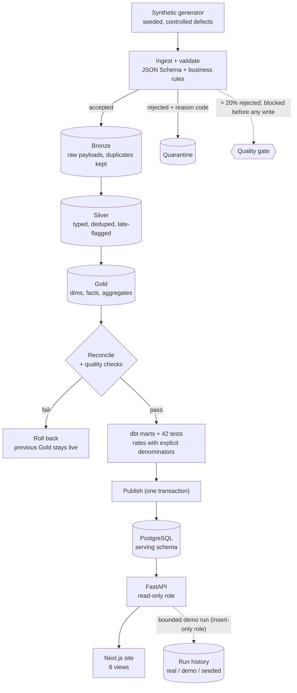
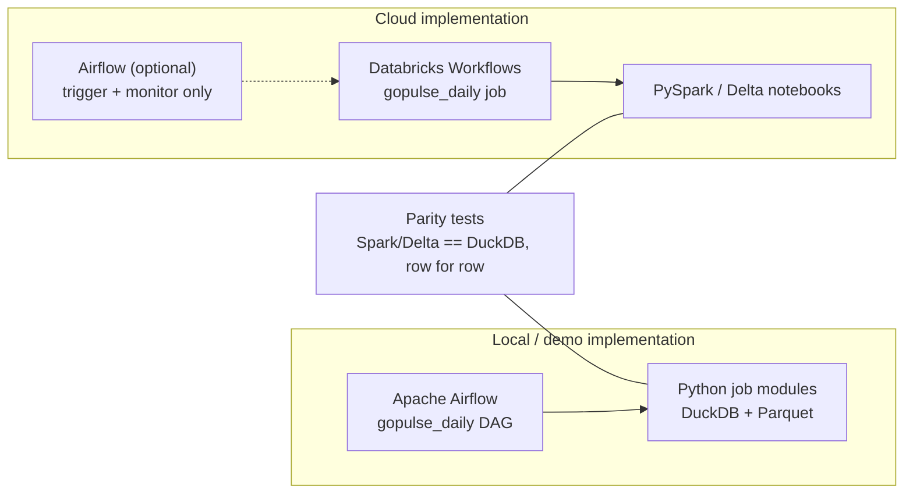
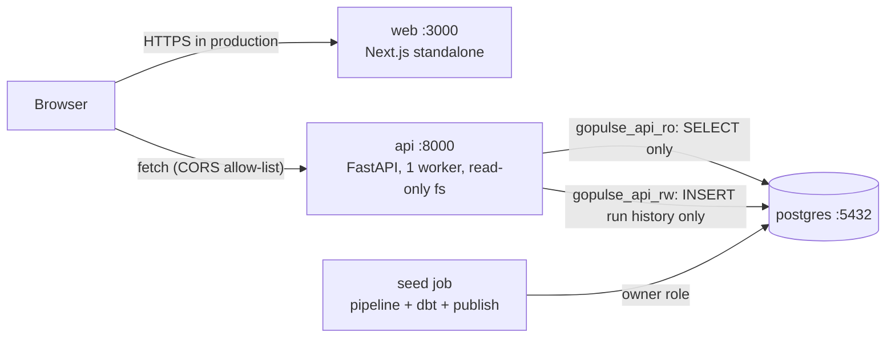

# Architecture

GoPulse turns a synthetic stream of product and AI-agent events into tested, documented analytics, and serves them through an API and a
website. Everything is reproducible from a seed; nothing uses real data.

## 1. End-to-end data flow

Silver is rebuilt per **event-date partition** touched by a batch, so late events repair the older partition they belong to without a fixed
lookback. The whole ingest → Silver → Gold → reconcile → quality sequence is **one transaction**: a failure at any step leaves the previous Gold
untouched (tested), and the failure is recorded in the run history.

## 2. Who schedules what

The same production run is never scheduled twice. The Databricks side is **tested for parity locally but not deployed** (see
[databricks/README.md](../databricks/README.md)).

## 3. Runtime topology (docker compose)

## 4. Trust and safety boundaries
| Boundary | Control |
|---|---|
| Browser → API | CORS allow-list, validated enums/regexes for every filter, bounded ranges, pagination caps, uniform error envelope, no stack traces |
| API → database | two least-privilege roles; dashboard queries cannot write or alter anything (tested); statement timeout 5 s |
| Demo run | closed request schema (no commands, SQL, paths or credentials), fixed workflow in a throw-away sandbox, per-client + global rate limits, one at a time, capped history |
| Secrets | environment variables only; `.env` git-ignored; images contain none; CI uses throw-away service credentials |
| Data | synthetic only; labelled on every page and API response; cost figures marked as estimates |

## 5. Technology map
| Concern | Choice | Why |
|---|---|---|
| Local engine | DuckDB + Parquet | same SQL, no cloud credentials, fast iteration; Spark parity-tested ([decision D1](decisions.md)) |
| Cloud engine | PySpark + Delta Lake on Databricks | the realistic production target; implemented and parity-tested, not deployed |
| Modelling & tests | dbt (dbt-duckdb) | reusable, documented, tested marts |
| Orchestration | Airflow (local), Databricks Workflows (cloud) | [decision D3](decisions.md) |
| Serving | PostgreSQL + FastAPI | cheap, familiar, filterable; the lakehouse stays the system of record |
| Web | Next.js 16, React 19, TypeScript, Tailwind, Recharts | static shell + client data fetching; WCAG-checked |
| Quality of the code itself | pytest, Vitest, Playwright + axe, ruff, actionlint | see [ci.md](ci.md) |

See also: [lineage](lineage.md) · [data dictionary](data_dictionary.md) · [metric definitions](metrics.md) · [event contract](event_contract.md) ·
[quality & failure demo](quality.md) · [API](api.md) · [orchestration](orchestration.md) · [decisions](decisions.md).
