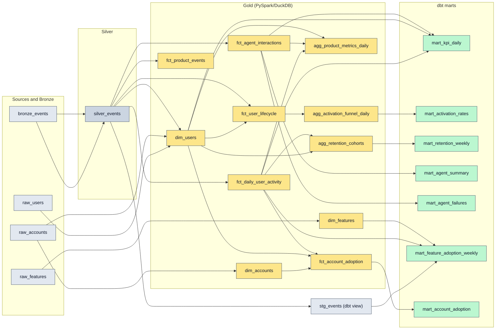

# Data lineage

Generated by `scripts/gen_docs.py` from `pipelines/catalog/catalog.yml` (the same metadata the Data Catalog page serves). Do not edit by hand.

Colours: grey = sources/Silver, yellow = Gold, green = dbt marts.
Gold is produced by `pipelines/jobs/gold.py` (DuckDB) and, in parity, `pipelines/spark/spark_pipeline.py` (PySpark/Delta); marts are dbt models that read Gold tables as dbt sources.
